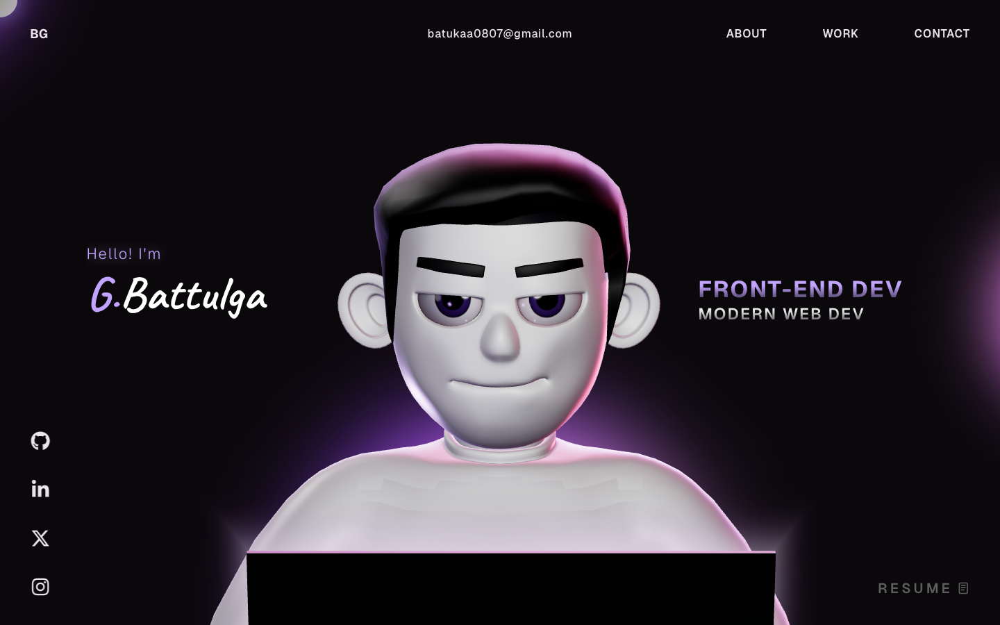

# Battulga.Port

> **Interactive 3D Developer Portfolio** engineered by **G.Battulga** ([@batettuk](https://github.com/batettuk)).

A modern, high-performance **3D interactive developer portfolio** built with **React 18**, **TypeScript**, **Three.js**, **GSAP**, and **WebGL**.



---

## ✨ Features & Highlights

- **3D Interactive Character & Rigged MacBook Pro**: Custom WebGL 3D character with interactive cursor tracking, glowing Apple hardware display, volumetric lighting, and camera transitions.
- **Playable Chess Engine (`/play`)**: Interactive chess board powered by Stockfish / RedoxChess WebAssembly. Play as White or Black (with automatic board flipping & opening move response), move highlighting, sound effects, checkmate victory/loss modal, and dynamic 3D Vanta.NET lavender particle background.
- **GSAP Scroll Choreography**: Silky smooth scroll scrubbing with customized 0.6s scrub timing, Lenis smooth scrolling, and split-text staggered reveals.
- **Dark Luxury Violet Aesthetic**: High-contrast, minimalist design with glowing lavender accents (`#c2a4ff`), handcrafted typography, and responsive layouts for desktop and mobile.
- **Connected Socials**: Direct links to GitHub, Facebook, Instagram, Discord, and Email.

---

## 🧰 Tech Stack

- **Core**: [React 18](https://react.dev/), [TypeScript](https://www.typescriptlang.org/), [Vite](https://vitejs.dev/)
- **3D & Graphics**: [Three.js](https://threejs.org/), [@react-three/fiber](https://r3f.docs.pmnd.rs/), [@react-three/drei](https://github.com/pmndrs/drei), [Vanta.js](https://www.vantajs.com/)
- **Animation & Motion**: [GSAP (GreenSock)](https://gsap.com/) & [ScrollTrigger](https://gsap.com/docs/v3/Plugins/ScrollTrigger/), [Lenis Smooth Scroll](https://lenis.darkroom.engineering/)
- **Chess Engine**: [chess.js](https://github.com/jhlywa/chess.js), [Stockfish](https://stockfishchess.org/) / RedoxChess WebAssembly
- **Styling**: Modern CSS3 (Grid, Flexbox, Glassmorphism, CSS Custom Properties)

---

## 🚀 Getting Started

### Prerequisites

- Node.js 18+ or [Bun](https://bun.sh/)

### 1. Clone the repository

```bash
git clone https://github.com/batettuk/Battulga.Port.git
cd Battulga.Port
```

### 2. Install dependencies

```bash
bun install
# or
npm install
```

### 3. Run development server

```bash
bun run dev
# or
npm run dev
```

Open [http://localhost:5173](http://localhost:5173) in your browser.

### 4. Build for production

```bash
bun run build
# or
npm run build
```

---

## 📬 Connect

- **GitHub**: [@batettuk](https://github.com/batettuk)
- **Facebook**: [g.battulga.g](https://www.facebook.com/g.battulga.g)
- **Instagram**: [@batuka_ggg](https://www.instagram.com/batuka_ggg/)
- **Discord**: [batettuk](https://discord.com/users/940206146130681856)
- **Email**: [batukaa0807@gmail.com](mailto:batukaa0807@gmail.com)

---

## 🪪 License

This project is licensed under the MIT License - see the [LICENSE](LICENSE) file for details.
